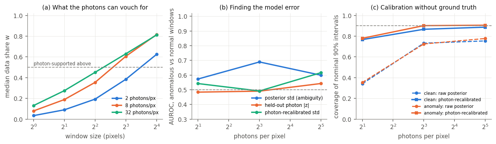
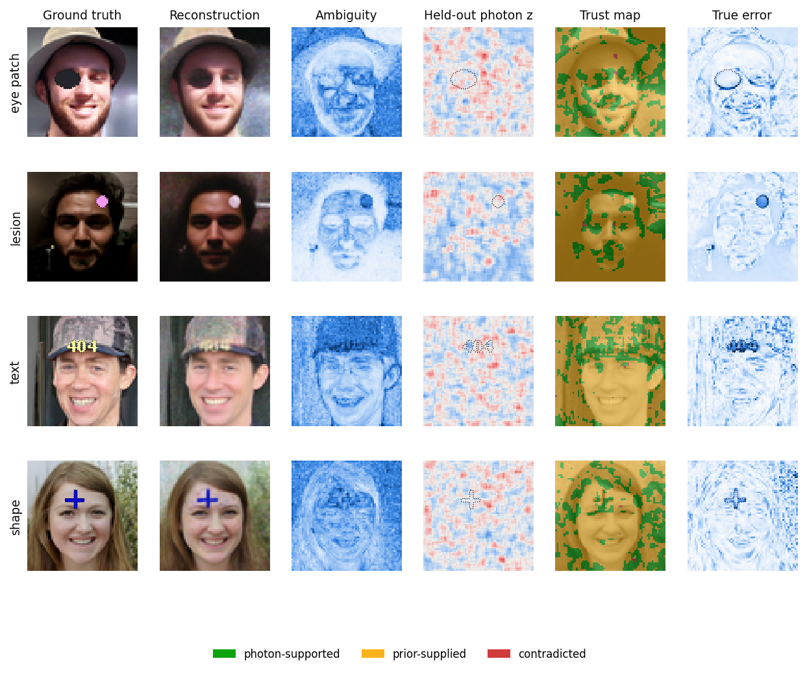
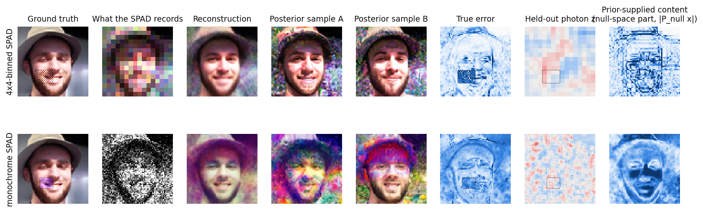
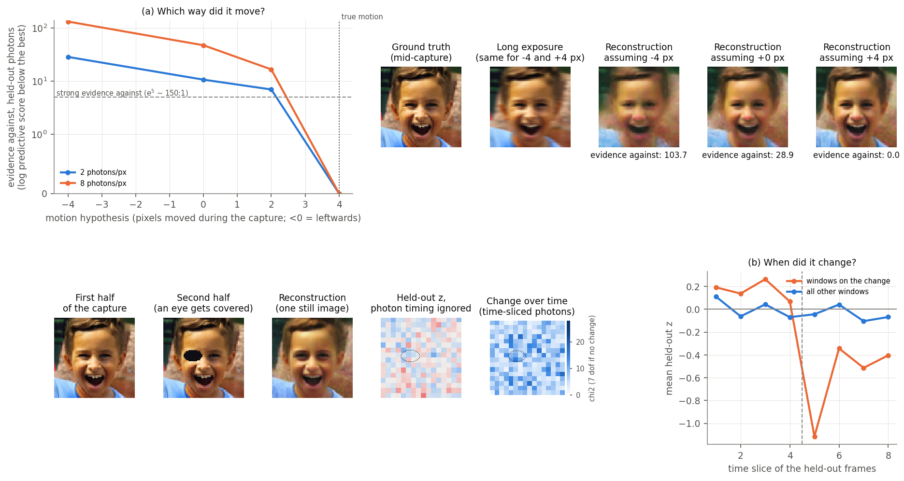
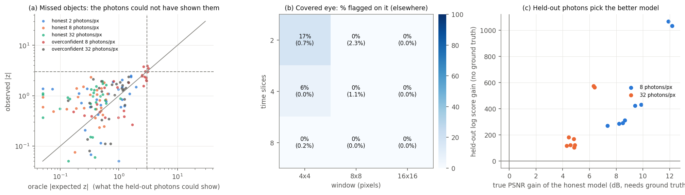

# photon-crossval

**Separating ambiguity from hallucination in generative single-photon imaging — with the photons themselves as the referee.**

A single-photon camera (SPAD) records hundreds of binary frames. Given the scene, the frames are independent, so the
photon stream can be split like a train/validation set: a diffusion-model reconstruction sees 75% of the frames and the
other 25% — photons it never saw — check it. No ground truth is needed, so the same checks would run on real captures.

This is a laptop-scale study (RTX 4060, 64×64 images, simulated sensor) of the question:

> How can a generative reconstruction separate uncertainty caused by genuinely ambiguous measurements from uncertainty
> caused by model error, and can physical consistency — across photons and across time — tell it which reconstructed
> details are actually supported by the sensor data?

## What the method computes

For every k×k window of a reconstruction (16 posterior samples from a diffusion prior):

| map | definition | question it answers |
|---|---|---|
| **ambiguity** | spread of the 16 posterior samples | what does the model admit it does not know? |
| **data share** *w* | posterior variance ÷ the variance from the photons alone (Cramér–Rao) | how much of the model's certainty comes from photons rather than from the prior? |
| **contradiction** *z* | held-out photon count vs. the posterior predictive (shot noise + posterior spread) | do photons the model never saw disagree with it? If the model is right, *z* ~ N(0,1) at any light level |
| **trust map** | photon-supported (*w* ≥ ½) / prior-supplied (*w* < ½) / contradicted (\|*z*\| > 3) | which details can be relied on? |
| **recalibration** | the held-out residual beyond its expected size, mapped back to image units | corrected error bars, without ground truth |
| **safe reconstruction** | photon-only window estimate wherever the photons contradict the model | rather incomplete than hallucinated |

**In time.** The binary frames keep their timestamps. For a moving scene we reconstruct under each motion hypothesis
(frames motion-compensated, still with the exact likelihood) and score every hypothesis against the *same* held-out
photons, sliced in time. Several hypotheses surviving = genuine ambiguity; exactly one = photon-supported motion;
none = model error.

## Setup

* **Prior:** NVIDIA's pretrained EDM diffusion model, FFHQ faces 64×64 (Karras et al. 2022).
* **Posterior sampler:** split-Gibbs PnP-DM (Wu et al., NeurIPS 2024) with an **exact** binary-frame likelihood step
  (each SPAD pixel's 1-D conditional sampled on a grid) and a variance-corrected (Tweedie/JVP) diffusion prior step;
  40 Gibbs iterations, 16 samples per scene.
* **Sensor:** 512 binary frames, Bernoulli detections *q* = 1 − exp(−flux), 2% dark counts, 2 / 8 / 32 photons per
  pixel over the whole capture; 25% of the frames held out.
* **Controlled model error:** scenes are drawn *from the prior itself* (so the prior is exactly right), then content a
  face model has never seen is pasted in — an eye patch, a coloured mark, printed text, a thin cross.
* **Unverifiable content:** a 4×4-binned SPAD with a checkerboard that leaves every SPAD-pixel mean unchanged, and a
  monochrome SPAD with an isoluminant colour patch — changes no photon can ever reveal.

## Results

### 1. Held-out photons calibrate the model without ground truth

| photons / pixel | 2 | 8 | 32 |
|---|---|---|---|
| PSNR of the posterior mean | 18.0 dB | 25.7 dB | 29.5 dB |
| raw 90% intervals: coverage of the truth | 34% | 73% | 75% |
| **after photon recalibration** | **77%** | **87%** | **89%** |
| held-out *E*[*z*²] on clean scenes (ideal 1) | 1.58 | 1.15 | 1.19 |
| windows flagged \|*z*\| > 3 on clean scenes (chance ≈ 0.3%) | 0.4% | 0.4% | 0.6% |

(4×4 windows; with 16 samples a perfectly calibrated sampler scores ≈ 87% on this coverage measure.) The sampler itself
needed this: with 20 Gibbs iterations its 90% intervals covered only 60% of the truth (contrast-compressed reconstructions,
i.e. too short a chain); 40 iterations reached 76%; the photons do the rest.



**What the photons can vouch for** (panel a): the median data share is only 0.03–0.13 per pixel at any photon level —
pixel-level detail is mostly the prior's — but rises above ½ for 8×8 windows at 8–32 photons/pixel.

### 2. An exact-likelihood posterior does not hallucinate where the photons can see

The surprise of the study. At 8–32 photons/pixel the posterior **reproduces** the pasted objects (with higher
uncertainty), so the held-out photons have nothing to contradict: their AUROC for finding the objects is ≈ 0.5, while
the ambiguity map does better (0.60–0.69). At 2 photons/pixel the objects *are* erased (a real hallucination: error
0.58 inside vs 0.22 outside) — but too few photons are held out to contradict it. There the data share does the work:
96% of windows are labelled prior-supplied, and only 4–5% of the large-error windows are labelled photon-supported.



### 3. When a reconstruction under-uses its photons, the check flags it

To mimic generative pipelines that lean on their prior, the same scenes and photons were reconstructed with the photon
likelihood down-weighted to 20%. That model hallucinates (it paints an eye over the patch, erases the mark, the text
and the cross), and the held-out photons flag it:

| photons / pixel | windows flagged, honest model | windows flagged, overconfident model | its coverage, raw → recalibrated |
|---|---|---|---|
| 8 | 0.4% | **19.5%** | 24% → 94% |
| 32 | 0.6% | **8.2%** | 46% → 87% |

Localisation is partial: at 8 photons/pixel, 36% of eye-patch windows are flagged vs 13% elsewhere, and 20% vs 5% for
the cross; the small mark and the thin text are lost among the model's other (washed-out) errors.
Figures: `results/beta0.2/figures/`.

### 4. Unverifiable content stays unverified

Checkerboard under the 4×4-binned SPAD: held-out *E*[*z*²] = 0.96, 0% of windows flagged, while the reconstruction is
wrong there (error 0.29). Isoluminant colour under the monochrome SPAD: *E*[*z*²] = 0.83, 1% flagged, error 0.31. No
photon can contradict these, by construction — the held-out check is silent, as it should be. What reveals them is the
other side of the ledger: the posterior samples disagree wildly about exactly the content the sensor cannot see (random
sub-pixel texture; arbitrary colours), and the null-space part of the reconstruction (last column) shows how much of the
image is supplied by the prior alone. (The data share and trust map are defined on the measured coordinates, so they do
not label null-space content; it has to be reported separately, as here.)



### 5. Time: which way did it move?

A face slides 4 pixels during the capture. A conventional long exposure is identical for a leftward and a rightward
motion; the time-sliced held-out photons are not. Evidence against each hypothesis (log predictive score below the best,
mean of 2 scenes; both scenes agree on the ordering):

| hypothesis (pixels moved) | −4 (mirror) | 0 (static) | +2 | **+4 (true)** |
|---|---|---|---|---|
| 2 photons / pixel | 28.7 | 10.7 | 7.0 | **0** |
| 8 photons / pixel | 132.8 | 47.5 | 16.7 | **0** |

At 2 photons/pixel — where the face itself is mostly prior-supplied — the photons still decide the direction: a global
quantity shared by every photon can be photon-supported even when per-pixel detail is not.

**When did it change?** Not demonstrated at 8 photons/pixel. A thin dark sticker appearing over the (dark) mouth
mid-capture was not detected — about one photon of difference per window per time slice. An eye being covered halfway
through gives a weak but consistent signal (change score 9.5 and 8.1 on the eye vs 6.8 and 7.0 elsewhere, in both
faces; ≈ 7 is expected with no change), but no window passes the 99% threshold (18.5): the held-out quarter of the
frames leaves only a few photons per window per time slice. A back-of-envelope estimate says about 4× more photons
would make it detectable — the temporal version of the photon-budget limit in result 2.



## What this says about the question

The results split "ambiguity vs. model error" three ways:

1. **Prior-supplied (unverifiable) content** — the data-share map. Most pixel-level detail at these photon levels.
2. **Genuine ambiguity** — the posterior spread, which (after photon recalibration) is calibrated.
3. **Contradiction** — model error the photons can see. With an exact likelihood, prior errors are corrected wherever the
   photons are informative, so contradictions mainly expose errors in the *physics* (a wrong motion model, a changing
   scene) and reconstructions that do not use their photons properly.

**Why the misses happened, and what follows** — see [docs/research_notes.md](docs/research_notes.md). In short: with the
true scene known, *none* of the honest model's object errors could have been flagged by any test on the held-out photons
(a photon-budget limit, not a failure of the check); held-out photons picked the honest over the overconfident
reconstruction in 16 of 16 paired cases without ground truth; and this suggests a detection–correction trade-off —
held-out photons cannot catch what an exact posterior would itself have fixed — which the notes turn into testable
predictions and a research plan. A first test (P1: prior over-trust × held-out share, 12 settings) supports it: the
honest posterior's errors carry under 1.2 nats of photon evidence at every held-out share, over-trusting the prior makes
it out-vote 5–32 nats, and flags on the hallucinated objects appear exactly when that evidence crosses the line set by
the held-out share — in all 12 settings, including 5 of 5 predicted in advance (`results/figures/fig10_tradeoff.png`).



## Limitations

* Simulation only; 64×64 faces; a face prior; laptop compute (4 scenes per condition, 2 for the motion experiment).
* Small or low-contrast hallucinations at low photon counts cannot be caught — the photons that would reveal them do
  not exist. The method then says *unverified*, not *verified*.
* The data share assumes the reconstruction uses the photon likelihood correctly: a mis-weighted posterior that is
  merely broad can look "photon-supported".
* Holding out 25% of the frames costs reconstruction quality; K-fold photon cross-validation would avoid it.

## Relation to prior work

* Lindell group: *Inter-Photon-Limited Videography* (CVPR 2026) asks what single photons can recover in time; the data
  share is a posterior-based, per-region version of that question. *Generating the Past, Present and Future from a
  Motion-Blurred Image* (SIGGRAPH Asia) samples both motion directions from a blurred photo; the time-sliced check shows
  how photon timing would pick the real one — and when it cannot.
* Sprunck, Pereyra & Liaudat (arXiv 2510.27663): data fission + Bayesian cross-validation for misspecification
  detection with diffusion priors — global scores from noise-injection splits; here the split is physically native
  (binary frames), spatially and temporally resolved, and used for recalibration.
* bit2bit (NeurIPS 2024): held-out photons as a self-supervised *training* signal. gQIR (arXiv 2602.20417): Stable
  Diffusion reconstructions of SPAD bursts, with no hallucination checks.

## Next steps

* **Real captures:** the public colour-SPAD dataset `aRy4n/real-color-SPAD-indoor6` (CC-BY) with a general image prior;
  a few frames as the capture and the full 6,000-frame sequence as a reference.
* A video diffusion prior in place of rigid motion hypotheses; K-fold photon cross-validation; testing the check on
  feed-forward generative SPAD pipelines.

## Running it

```bash
python scripts/run_study.py --experiment validate --iters 40            # ~5 min: sampler calibration
python scripts/run_study.py --experiment main --iters 40 --scenes 4     # clean vs pasted objects, 2/8/32 photons/px
python scripts/run_study.py --experiment main --iters 40 --beta 0.2 --levels 8 32 --out results/runs_beta0.2
python scripts/run_study.py --experiment lowres --iters 40 --scenes 2   # 4x4-binned SPAD + null-space checkerboard
python scripts/run_study.py --experiment mono --iters 40 --scenes 2     # monochrome SPAD + isoluminant patch
python scripts/run_motion.py --iters 40 --levels 2 8 --hyps -4 0 2 4    # time: motion hypotheses + mid-capture changes
python scripts/analyze.py                                               # figures 1-6, 8 and results/summary.{json,md}
python scripts/analyze.py --runs results/runs_beta0.2 --out results/beta0.2
python scripts/analyze_motion.py                                        # figure 7 and results/summary_motion.json
python scripts/diagnose_failures.py                                     # figure 9: oracle detectability, pooling, model selection
# P1 sweep: prior over-trust (beta) x held-out share (holdout), pasted-object scenes only, same photons
python scripts/run_study.py --experiment main --iters 40 --scenes 4 --levels 8 --variants anomaly --beta 0.5 --holdout 0.5 --out results/p1/b0.5_f0.5
python scripts/analyze_p1.py                                            # figure 10 and results/summary_p1.json
```

All runs are resumable (one file per scene/condition) and pause when the GPU passes 80 °C (`--t-max`, `--t-resume`).

**Setup** (PyTorch with CUDA, plus numpy, scipy, scikit-learn, matplotlib, Pillow): the EDM code and the pretrained
prior are not in this repository — fetch them once:

```bash
git clone --depth 1 https://github.com/NVlabs/edm.git third_party/edm
mkdir -p checkpoints && curl -L -o checkpoints/edm-ffhq-64x64-uncond-vp.pkl \
  https://nvlabs-fi-cdn.nvidia.com/edm/pretrained/edm-ffhq-64x64-uncond-vp.pkl
```

Raw runs (`results/runs*/`, `results/p1/`) are not tracked either; the figures and `results/summary*.json` are.

| file | role |
|---|---|
| `src/pxv/sensor.py` | binary-frame SPAD model, frame splitting, likelihood, Fisher information |
| `src/pxv/prior.py` | EDM prior as a Gaussian-denoising posterior sampler (JVP variance correction) |
| `src/pxv/sampler.py` | PnP-DM split-Gibbs posterior sampler with the exact likelihood step |
| `src/pxv/checks.py` | ambiguity, data share, held-out photon z, trust labels, recalibration |
| `src/pxv/motion.py` | moving scenes, motion compensation, time-sliced predictions |
| `src/pxv/anomalies.py` | pasted objects and null-space (unverifiable) patterns |
| `src/pxv/metrics.py` | ground-truth scoring (simulation only) |
